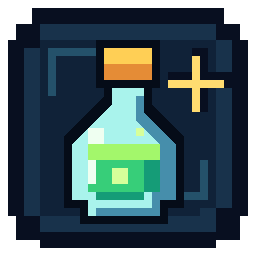
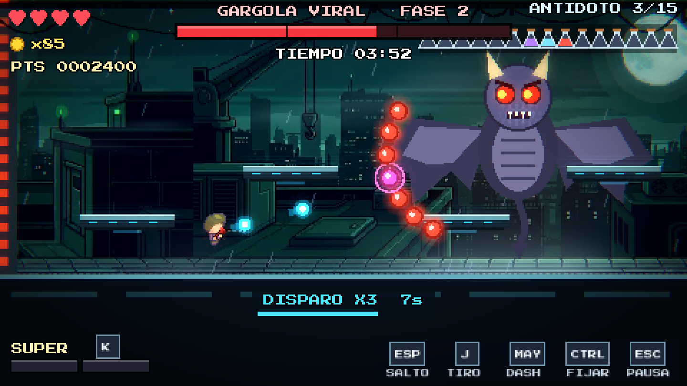
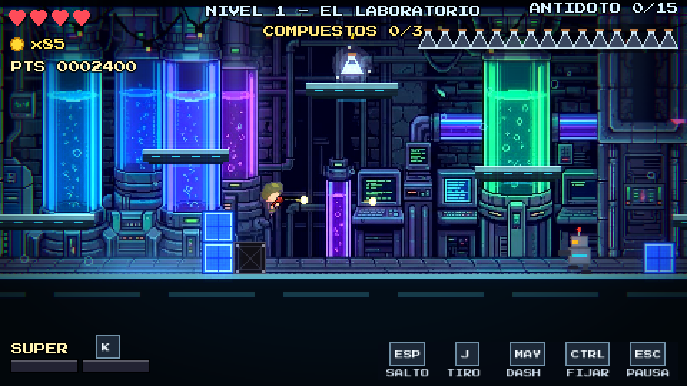
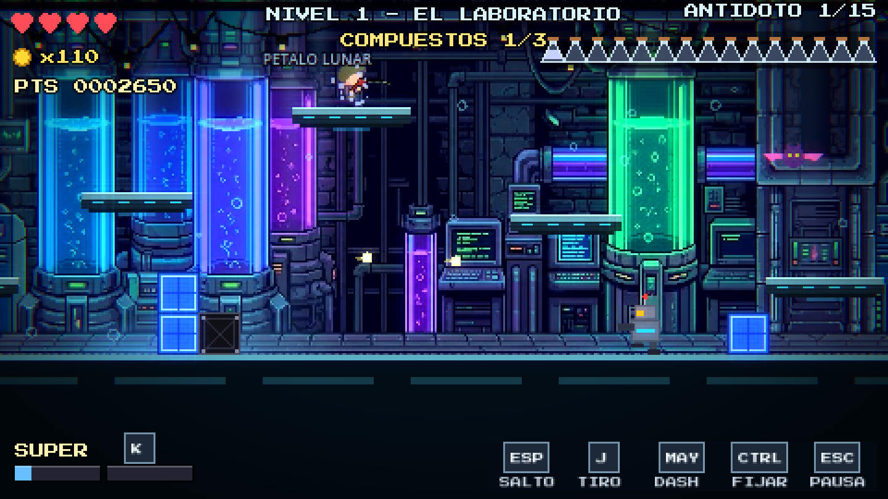
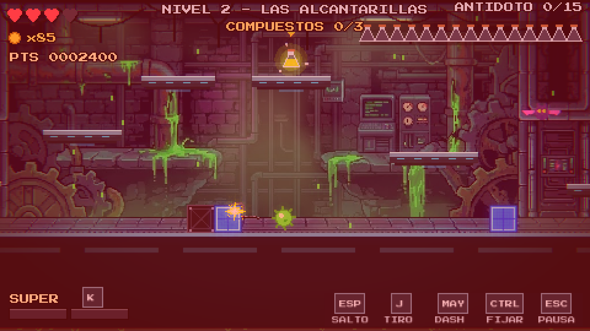
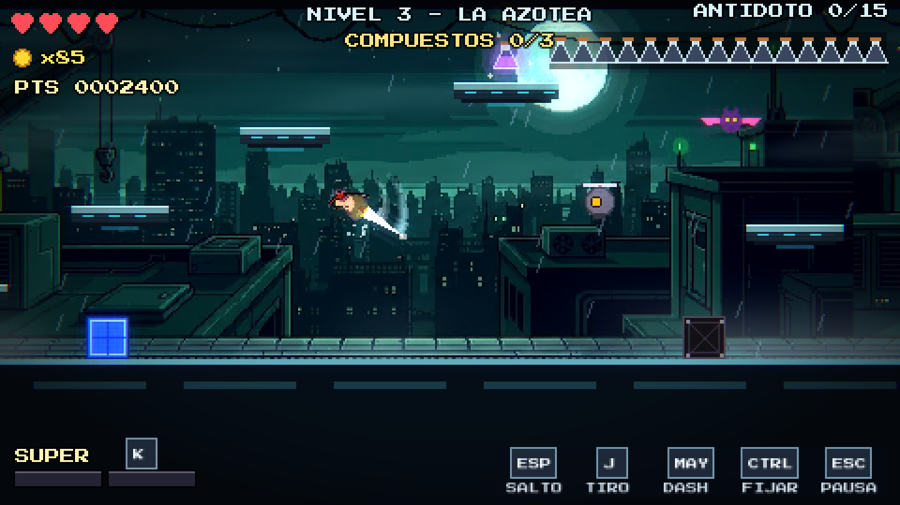
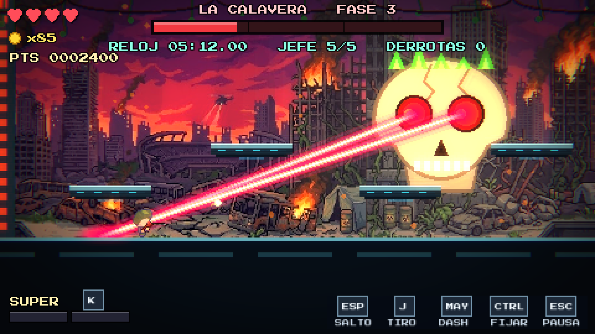
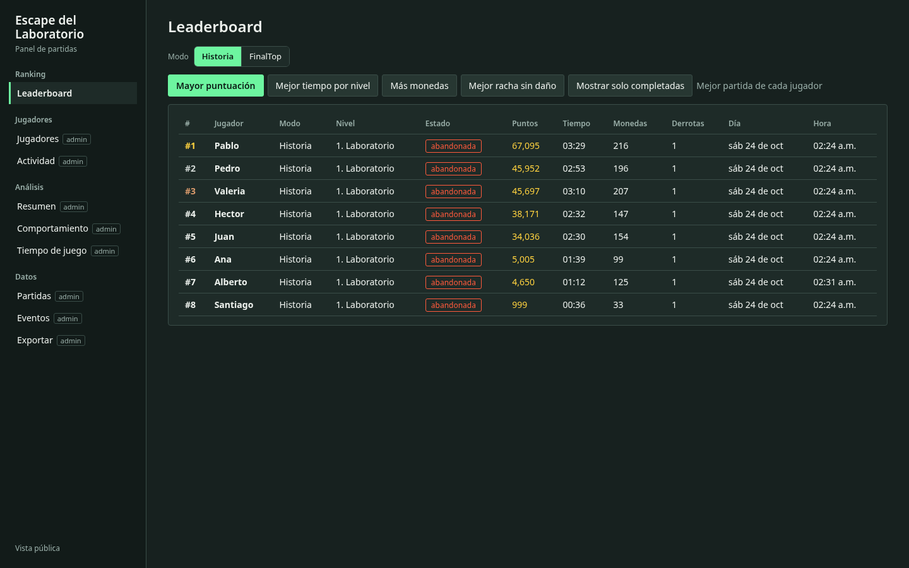

<p align="center">
  
</p>

# Escape del Laboratorio

**El virus se propaga. La cura depende de ti.**

Un juego de acción y plataformas 2D en pixel art. Recorre cinco zonas contaminadas, reúne los **15 ingredientes del antídoto** y enfréntate a cinco jefes antes de que se agote el tiempo. Combina disparos, dash, parry y una espada que aparece durante el salto doble para abrirte paso hasta la cura.



**Godot 4.7 · Un jugador · Teclado, ratón, mando y táctil · Historia y FINALTOP**

[Empezar a jugar](#jugar) · [Galería](#galería) · [Controles](docs/CONTROLES.md) · [Documentación](#documentación) · [Créditos](docs/CREDITOS.md)

## El juego

- **Cinco escenarios conectados por una misión.** Laboratorio, alcantarillas, azotea, pista y ruinas: explora sus plataformas, recoge los compuestos, elimina a los enemigos y abre la arena de cada jefe.
- **Combate con movimiento.** Dispara mientras te desplazas, encadena un salto doble con espada, atraviesa peligros con dash y rebota con parry sobre los objetos rosas.
- **Jefes con identidad.** Baba que ralentiza, tinta en pantalla, ráfagas y espinas, abducción y ojos láser. Cada enfrentamiento tiene tres fases y patrones que responden a la distancia.
- **Respuestas claras.** Impactos animados, partículas, destellos, sonido, pausas breves de impacto y vibración del mando. El buffer de salto y el coyote time ayudan a que los controles respondan incluso cerca de los bordes.
- **Una segunda forma de jugar.** Desbloquea **FINALTOP** al completar la historia: cinco jefes seguidos, clasificación por menor tiempo y una penalización de 15 segundos por derrota.
- **Partidas que puedes retomar.** Guarda desde la pausa. Juega como invitado con guardado local o inicia sesión para registrar progreso y resultados en PostgreSQL.

## Galería

| Explora el laboratorio | Recoge el antídoto |
|---|---|
|  |  |

| Siente los impactos | Domina el salto doble |
|---|---|
|  |  |



Capturas renderizadas en Godot con escenas preparadas de la versión actual. [Galería completa y reproducción de las capturas](docs/CAPTURAS.md).

## Jugar

El repositorio contiene el proyecto fuente; se ejecuta desde Godot.

1. Clona el repositorio:

   ```bash
   git clone https://github.com/LuisVerduzco822/Escape_del_laboratorio.git
   cd Escape_del_laboratorio
   ```

2. Importa **`game/project.godot`** en **Godot 4.7** y ejecuta con **F5**.
3. Elige **Jugar sin conexión** para entrar como invitado. No necesitas cuenta, base de datos ni servidor.
4. Abre **TUTORIAL** para practicar o **NUEVA PARTIDA** para comenzar la historia.

También puedes iniciar el proyecto desde una terminal:

```bash
godot --path game
```

**Guardar:** abre **PAUSA → GUARDAR Y SALIR**. **CONTINUAR** recupera el recorrido o el inicio de la fase del jefe guardada. Al morir frente a un jefe, **REINTENTAR** reinicia el combate completo y conserva los ingredientes. [Reglas de guardado y modos](docs/JUGABILIDAD.md).

### Controles básicos

| Acción | Teclado / ratón | Mando |
|---|---|---|
| Mover | A / D o flechas | Stick izquierdo / D-Pad |
| Apuntar | W / S y dirección de movimiento; modo ratón opcional | Stick derecho |
| Saltar / salto doble / parry | Espacio o Z | A / ✕ o X / □ |
| Disparar | J, X o clic izquierdo | RT / R2 |
| Dash | Shift, L o clic derecho | B / ○ o RB / R1 |
| Súper / ultra | K o V | LT / L2 o Y / △ |
| Fijar posición | Ctrl o I | LB / L1 |
| Pausa | Esc o P | Start / Options |

Las asignaciones se pueden cambiar en **CONTROLES**. Los menús y las ayudas muestran el dispositivo activo y las entradas reasignadas. [Guía de teclado, ratón y mando](docs/CONTROLES.md).

**Táctil / Android:** stick izquierdo para moverse, zona derecha para apuntar y activar fuego continuo, TIRO para apagarlo y botones de salto, dash y súper/ultra. Visibilidad, tamaño y opacidad se ajustan en **CONTROLES → TÁCTIL**. [Generar el APK, instalarlo y probarlo manualmente](docs/ANDROID.md).

## Cuentas, ranking y panel local

El servidor es opcional para jugar. Al iniciar sesión, permite registrar partidas, consultar clasificaciones y recuperar progreso entre niveles. El panel web ofrece rankings públicos y vistas de administración con eventos, trayectorias, mapas de calor y exportación CSV. Los datos del invitado permanecen en su equipo.



Con **Docker y Docker Compose**, desde la raíz:

```bash
docker compose up --build
```

Abre **http://localhost:3000** para el panel y usa esa misma dirección en la pantalla de acceso del juego. La base se inicializa al arrancar el servidor. Configura `ADMIN_PASSWORD` antes de usar las vistas de administración.

Si prefieres instalar Node.js y PostgreSQL directamente, sigue la [guía de instalación local](docs/GUIA_POSTGRESQL.md). Los endpoints están descritos en [docs/API.md](docs/API.md).

## Game feel

| Ajuste | Valor actual |
|---|---|
| Buffer de salto | 100 ms |
| Coyote time | 90 ms; conserva el salto aéreo |
| Screenshake al recibir daño | 3 px durante 250 ms, a resolución base de 480 × 270 |
| Pulso de mando al disparar | 35 ms; motores débil / fuerte: 0.18 / 0.04 |
| Prioridad del mando | Los impactos interrumpen y bloquean los pulsos de disparo |
| Hitstop al recibir daño | 80 ms; escala de tiempo 0.05 |

El movimiento normal y los aterrizajes no sacuden la cámara. El aterrizaje fuerte tiene polvo y sonido; las sacudidas se reservan para daño, especiales y eventos importantes de los jefes. [Parámetros completos, implementación y pruebas](docs/GAME_FEEL.md).

## Desarrollo

```text
game/                 Juego, recursos, pruebas y herramientas de Godot
server/               API Express, esquema PostgreSQL y panel web
docs/                 Guías, decisiones técnicas y evidencias
docs/media/capturas/   Capturas actuales del juego y la web
```

El juego se comunica mediante HTTP/JSON con una API Node.js; la API accede a PostgreSQL. [Arquitectura y ejecución de pruebas](docs/DESARROLLO.md).

```bash
python3 game/tools/run_tests.py --jobs 3
```

El ejecutor usa guardados temporales y considera fallos los errores de ejecución y los avisos de recursos retenidos. Las **38 suites** pasaron en la revisión de recursos; también se repitieron 24 ejecuciones de los casos de audio y cierre sin fugas. Las pruebas de servidor requieren su propia base de datos de pruebas.

## Documentación

| Consulta | Documento |
|---|---|
| Campaña, jefes, FINALTOP y guardados | [Jugabilidad](docs/JUGABILIDAD.md) |
| Asignaciones, perfiles y dispositivos | [Controles](docs/CONTROLES.md) |
| Buffer, coyote, cámara, feedback y rumble | [Game feel](docs/GAME_FEEL.md) |
| Capturas y herramientas para reproducirlas | [Galería](docs/CAPTURAS.md) |
| Arquitectura, parámetros y validación | [Desarrollo](docs/DESARROLLO.md) |
| Instalación de PostgreSQL y servidor | [Guía local](docs/GUIA_POSTGRESQL.md) |
| API y consultas SQL | [API](docs/API.md) · [Consultas](docs/consultas.sql) |
| Evidencias académicas | [Práctica 4](docs/PRACTICA4.md) · [Práctica 5](docs/PRACTICA5.md) |
| Recursos y atribuciones | [Créditos y licencias](docs/CREDITOS.md) |

## Créditos y uso de recursos

El juego combina arte proporcionado para el proyecto, recursos de terceros y elementos generados para esta versión. Las atribuciones también están disponibles en **CRÉDITOS** dentro del juego.

Las licencias de cada recurso se conservan junto a sus archivos. Hay recursos con condiciones de uso no comercial; no se declara una licencia global de código en este repositorio. Consulta [Créditos y licencias](docs/CREDITOS.md) antes de reutilizar o distribuir materiales.
