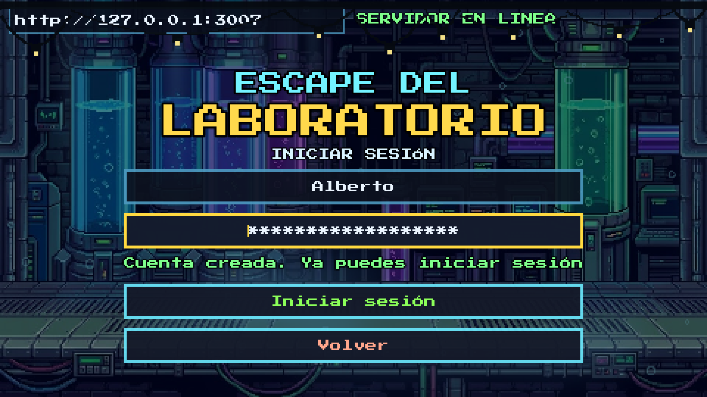
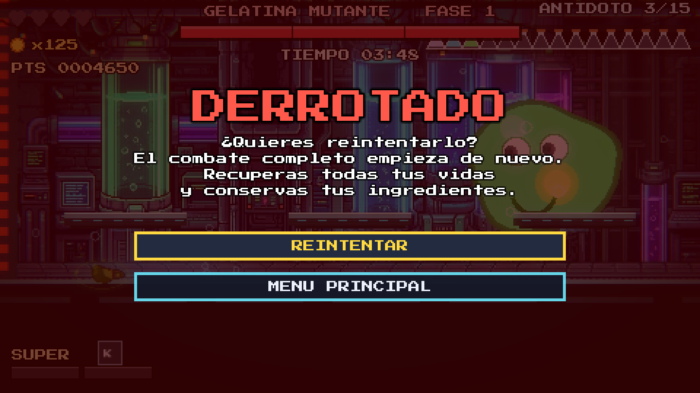

# Galería y capturas reproducibles

[Volver al proyecto](../README.md) · [Evidencias de la práctica 5](PRACTICA5.md)

Las imágenes de `docs/media/capturas/` corresponden a la versión actual. Las del juego se renderizaron en **Godot 4.7.2**, con escenas y acciones preparadas mediante herramientas del repositorio. Se guardó el viewport y se escaló con vecino más cercano a **1440 × 810**; no se añadieron textos, interfaces ni efectos por fuera del juego.

Son imágenes de presentación y evidencia visual de acciones. No representan una sesión completa jugada manualmente ni prueban por sí solas los tiempos del buffer, el coyote o el screenshake. El video sigue siendo una entrega independiente.

## Acción y recorrido

### Laboratorio


### Recolección


### Daño


### Salto doble y espada


### Jefe y potenciador


### FINALTOP


## Vistas recreadas a partir de la referencia

Se recrearon las tres situaciones del documento de capturas: inicio de sesión, derrota contra la Gelatina Mutante y leaderboard web. El diseño y los textos son los de la versión actual; las imágenes no se extrajeron del PDF.

### Inicio de sesión



El formulario registra la cuenta **Alberto** en la API local y presenta su respuesta real. El nombre reproduce el de la referencia; la cuenta pertenece únicamente a la base temporal de capturas.

### Derrota y reintento



Se prepara el estado de la partida y se aplica daño letal mediante `Player.hurt()`. La pantalla se abre por el flujo de derrota del juego. `Telemetry.finish(false)` envía los datos a la API y el script comprueba que la respuesta del leaderboard contiene **Alberto / 4,650 puntos / 125 monedas** antes de guardar la imagen.

### Leaderboard web


Captura nueva del panel servido por Express y PostgreSQL. Alberto corresponde a la partida preparada y registrada desde Godot; las demás filas son cuentas y partidas de ejemplo creadas por la API para mostrar una tabla representativa, con nombres y puntuaciones de la referencia. No son récords de jugadores reales. La interfaz se capturó en navegador a **1440 × 900**, sin bordes de escritorio.

## Regenerar las capturas del juego

Desde la raíz del repositorio, en Linux con sesión gráfica:

```bash
XDG_DATA_HOME=/tmp/escape-gallery.save-check \
  godot --path game --windowed --resolution 960x540 --fixed-fps 60 \
  --script res://tools/capture_gallery.gd
```

La herramienta usa un directorio de datos aislado y el modo invitado. Su semilla fija prepara los mismos actores y patrones; el tiempo del shader y las partículas puede producir pequeñas diferencias entre ejecuciones. Escribe las primeras seis imágenes en `docs/media/capturas/`. También acepta un directorio de salida como primer argumento después de `--`.

No utilizar `--headless`: ese modo no renderiza las imágenes necesarias. En Windows, establece `APPDATA` en un directorio temporal cuyo nombre contenga `.save-check` antes de ejecutar el mismo comando de Godot.

## Regenerar login y derrota conectados

Se necesita una **API de capturas con base nueva y separada**. No usar una base personal: la herramienta crea la cuenta Alberto y una partida de ejemplo. Con ese servidor disponible:

```bash
XDG_DATA_HOME=/tmp/escape-gallery-online.save-check \
ESCAPE_API_URL=http://127.0.0.1:3007 \
  godot --path game --windowed --resolution 960x540 --fixed-fps 60 \
  --script res://tools/capture_online.gd
```

`capture_online.gd` crea la cuenta desde el formulario, inicia sesión, registra la derrota y contrasta el ranking. Después escribe `07-inicio-sesion.png` y `08-derrota.png`. Una base que ya tenga Alberto debe reemplazarse por otra base de capturas vacía para repetir todo el flujo de registro. Para repetir solo la derrota y conservar la imagen del registro, se puede añadir `-- --reuse` al comando.

Para la web, abre la misma API en un navegador, espera a que cargue el ranking y guarda la vista a 1440 × 900 como `09-leaderboard.png`. Con solo la herramienta de Godot habrá una fila; las filas adicionales de esta galería son ejemplos añadidos a esa base temporal mediante la API.

Los servicios de esta sesión se ejecutaron con un proyecto Compose independiente, sin reutilizar el volumen `pgdata` ni las cuentas del juego. Los PNG anteriores en `docs/` y `docs/capturas/` se conservan como material histórico; el README y las evidencias actuales enlazan esta galería.
