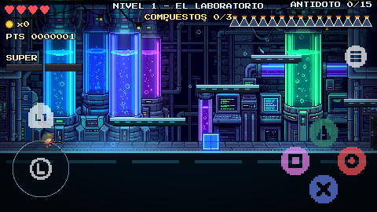
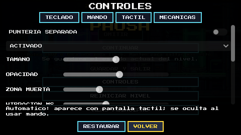

# Práctica 6 · Controles táctiles y adaptación a móvil

[Volver al proyecto](../README.md) · [Android y APK](ANDROID.md) · [Game feel](GAME_FEEL.md)

Rama de trabajo: `practica-6` (misma base de código que la Práctica 5). Se conservan la base de datos, el registro de progreso, el leaderboard, el panel web local y los efectos de game feel.

## Cumplimiento de los requisitos

| Requisito | Implementación | Dónde |
|---|---|---|
| Joystick virtual con zona muerta ajustable | Stick izquierdo de 37 px de radio (en el lienzo de 480×270). Zona muerta ajustable entre 0.10 y 0.40 (por defecto 0.20) en **CONTROLES → TÁCTIL → ZONA MUERTA**; el valor se reescala para que el recorrido útil siga llegando a 1.0 | `TouchControls.gd`, `GameManager.set_touch_extra` |
| Botones de acción grandes | Salto (cruz), disparo (cuadrado), dash (círculo), súper (triángulo), fijar (L1) y pausa. Radio de 21 px (18 px fijar/pausa) en el lienzo, que en un teléfono de 1080p equivale a ≥ 144 px físicos; en un teléfono real ningún botón baja de **96 px físicos** (`MIN_BUTTON_PX`) | `TouchControls._radius` |
| Multitouch | Cada dedo conserva su papel hasta soltarse (`fingers`): mover + saltar + dash a la vez; un dedo que se arrastra fuera de un botón no activa otro | `TouchControls.handle_touch` |
| Capa de entrada unificada | El personaje lee acciones nativas del Input Map (`play_move_left`, `play_jump`, `play_shoot`…), publicadas por el adaptador con `Input.action_press/release`. El táctil también usa acciones de origen `touch_*`. La puntería se resuelve en el adaptador y llega como `play_look_*`; el personaje no consulta el dispositivo. Se conserva la detección del mando para iconos y ayudas | `GameManager.gd`, `Player.gd`, `TouchControls.gd` |
| Controles solo en móvil | Visibilidad **automática**: aparecen con pantalla táctil o al detectar un toque, y se ocultan al usar mando. **Depuración en PC:** ACTIVADO en el selector, o la opción **RATON COMO DEDO** (o `--touch-debug`), que convierte el clic izquierdo en un dedo | `GameManager.touch_controls_visible`, `touch_mouse_debug_active` |
| Adaptación de pantalla | Horizontal (`handheld/orientation=4`, sensor paisaje), `stretch/mode="viewport"` sobre 480×270, anclas calculadas desde la **zona segura** (`DisplayServer.get_display_safe_area`) para que ningún botón quede bajo una muesca o borde | `project.godot`, `TouchControls._layout` |
| Integración con game feel | Los botones táctiles producen las mismas acciones, así que el **input buffering (0.10 s)** y el **coyote time (0.09 s)** funcionan igual. Verificado en `touch_practice_test.gd` | `Player.gd` |
| Vibración háptica opcional | `Input.vibrate_handheld` al **recibir daño** (duración completa), al **recoger** ingredientes, vida y power-ups (60 %) y al recoger **monedas** (mínima y con límite de frecuencia). Permiso `VIBRATE` en el preset de Android. Solo si se usan controles táctiles; no vibra si el jugador usa mando | `GameManager.haptic` |
| Ajustes de controles | **CONTROLES → TÁCTIL**: visibilidad, puntería separada, tamaño (85–115 %), opacidad (35–100 %), zona muerta, vibración (sí/no y duración 30–80 ms) y depuración con ratón. Se guardan en `user://touch.cfg`; RESTAURAR vuelve a los valores de fábrica | `ControlsPanel.gd` |

## Capturas

## Parámetros usados

| Parámetro | Valor de referencia | Valor usado |
|---|---|---|
| Radio del joystick | 80–120 px | 37 px en el lienzo de 480×270 (≈ 148 px de radio en un teléfono de 1080p, escala 4×) |
| Zona muerta | 0.15–0.25 | 0.20 por defecto; ajustable de 0.10 a 0.40 |
| Tamaño mínimo de botones | ≥ 96 px (≈ 9 mm) | ≥ 96 px físicos garantizados en teléfonos (42 px de diámetro en el lienzo ≈ 168 px a 1080p) |
| Opacidad de controles | 0.4–0.7 | 0.70 por defecto; ajustable de 0.35 a 1.00 |
| Duración de vibración | 30–80 ms | 50 ms por defecto (daño); 30 ms en monedas; ajustable de 30 a 80 ms |
| Orientación y stretch | Landscape, canvas_items + expand | Landscape (sensor); `viewport` sobre 480×270 para conservar el pixel art nítido y la misma composición de la pantalla que en PC |

Se eligió `viewport` en lugar de `canvas_items + expand` porque el juego está diseñado en 480×270 con arte de píxeles: `viewport` escala todo el cuadro de forma entera y evita bordes borrosos; en pantallas más alargadas que 16:9 quedan barras laterales que, además, coinciden con las muescas del teléfono.

## Cómo jugarlo en el celular

1. Compila el APK de depuración: `python game/tools/build_android.py --godot "C:/ruta/Godot_v4.7.2-stable_win64_console.exe"` (necesitas Godot 4.7.2, sus plantillas de exportación y el SDK de Android; ver [ANDROID.md](ANDROID.md)).
2. Pasa `game/builds/Escape-del-Laboratorio-debug.apk` al teléfono (cable USB, Drive o mensajería) e instálalo permitiendo «instalar apps de esta fuente». Con depuración USB también sirve `python game/tools/android_manual.py --serial TU_SERIAL install`.
3. Para iniciar sesión y registrar partidas, escribe en la pantalla de acceso la dirección del servidor en tu red (por ejemplo `http://192.168.1.20:3000`), no `localhost`. Sin servidor puedes entrar como invitado.
4. Para probar los controles en PC sin celular: **CONTROLES → TÁCTIL**, visibilidad **ACTIVADO** y **RATON COMO DEDO**; o ejecuta `godot --path game -- --touch-debug`.

## Pruebas

- `game/tests/touch_controls_test.gd`: diseño del diamante, multitouch, ajustes, GUI.
- `game/tests/touch_practice_test.gd` (nuevo): zona muerta, ajustes persistentes y acotados, tamaño mínimo físico, tres dedos a la vez, buffer y coyote con botones táctiles, vibración (daño, recoger, apagada, mando, límite de monedas) y ratón como dedo.
- Ejecución: `python game/tools/run_tests.py --godot <ruta a Godot>`.

## Interfaz web local en el celular

El panel web (`server/public`) no necesita instalarse en el teléfono: el celular abre `http://IP_DE_LA_PC:3000` en el navegador, en la misma red.

- Funciona: leaderboard, y las vistas de administración, incluida la nueva pestaña **Repeticiones**. Las tablas se desplazan horizontalmente, el menú se acomoda arriba y la lista de intentos pasa encima del reproductor.
- Limitaciones: el mapa de calor y la repetición se ven pequeños en una pantalla vertical (conviene girar el teléfono); algunas tablas anchas requieren desplazamiento horizontal; en un teléfono no hay «pasar el ratón» para ver los detalles emergentes, se muestran al tocar. Los datos siguen guardándose en PostgreSQL en la computadora que corre el servidor; el teléfono nunca guarda base de datos propia.
- Si el juego en el teléfono no alcanza el servidor, funciona sin conexión como invitado y el progreso queda solo en el teléfono.
